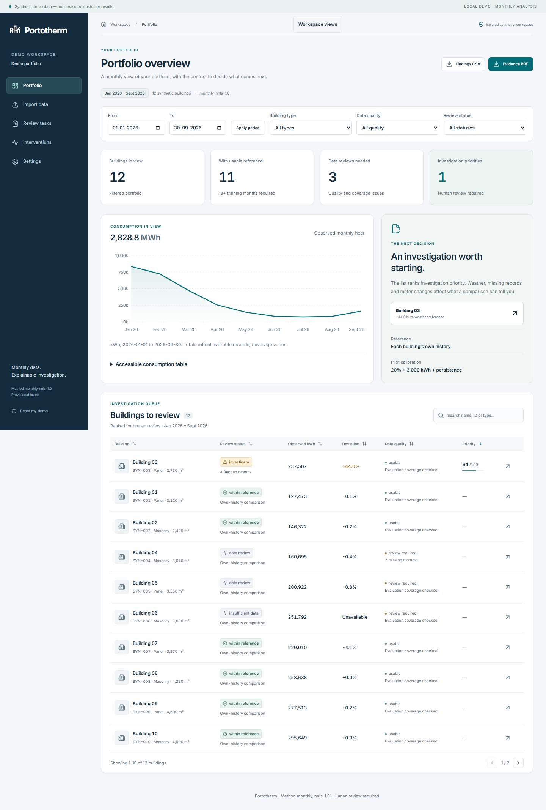

# Portotherm

**Provisional brand, clearance pending.** Heating Portfolio Analytics is a local demonstration for investigating monthly apartment-building heat consumption. English product and pitch, Turkish preparation notes. No verified customer, company, pilot result, grant or saving is claimed.

## Start in five minutes

Requirements: Python 3.11 and Node 24; internet for the initial dependency installation. Once installed, the core local demo works offline; optional Claude requests need network access.

Windows PowerShell, from repository root:

```powershell
.\scripts\start.ps1
```

Open [local demo](http://127.0.0.1:8000) and choose **Explore the demo**. API schema: [OpenAPI UI](http://127.0.0.1:8000/api/docs).

Manual cross-platform setup:

```sh
python -m venv .venv
# Windows: .venv/Scripts/activate; Linux/macOS: source .venv/bin/activate
python -m pip install -r requirements.lock.txt
cd apps/web
npm ci
npm run build
cd ../..
python -m alembic upgrade head
python -m apps.api.seed
python -m uvicorn apps.api.main:app --host 127.0.0.1 --port 8000
```

SQLite is the verified local path. PostgreSQL/Compose target:

```sh
cp .env.example .env
# Set POSTGRES_PASSWORD to a random URL-safe local password in .env.
docker compose up --build
```

Compose publishes only 127.0.0.1:8000, waits for PostgreSQL health, runs migration, seeds only demo mode, then starts the app. It does not read DATABASE_URL from the host .env into the container; the container uses its explicit PostgreSQL URL. A seed is idempotent and never deletes data. Reset affects only your isolated browser demo workspace. Python does not auto-read .env for manual startup: export environment variables explicitly when using nondefault settings.

## What works

- Twelve deterministic synthetic buildings, 33 months, separate scenario labels, synthetic HDD weather.
- Real backend CSV/macro-free XLSX preview, column mapping, unit/date/area/duplicate validation, explicit commit/skip policy and analysis.
- Explainable own-history weather reference with out-of-time evaluation, insufficient-data and quality states.
- Searchable, sortable, paginated portfolio, applied-period reports, reloadable building routes, chart/table/reasons, review tasks/history, interventions and audited settings.
- Tenant-scoped CSV/PDF evidence, isolated signed-cookie demo workspaces, pilot API JWT verification and admin/analyst/viewer authorization.

All screens/exports disclose **Synthetic demo data — not measured customer results**. Do not upload real customer records into the demo. The engine does not diagnose faults, control heating, certify audits or verify savings.



## Verification

```sh
python -m ruff check .
python -m pytest -q
cd apps/web
npm run build
npm test
npm run format:check
# App must already be running:
npx playwright install chromium
npm run e2e
```

Set BROWSER_EXECUTABLE to an existing Chromium binary if necessary. Browser tests capture actual screens and download reports. CI uses a fresh Playwright browser and synthetic data only. Local execution evidence and limitations: [acceptance checklist](docs/acceptance-checklist.md), [validation record](reports/validation.md), [STATUS](STATUS.md). No CI run is claimed until GitHub actually runs it.

## Deliverables and reproduction

- [12-slide editable presentation](presentations/exports/Portotherm-LIAA-Claude.pptx), [matching PDF](presentations/exports/Portotherm-LIAA-Claude.pdf).
- [One-page overview](presentations/exports/Portotherm-One-Pager.pdf), [three-page pilot proposal](presentations/exports/Portotherm-Pilot-Proposal.pdf), [brand guide](presentations/exports/Portotherm-Brand-Guide.pdf).
- [SVG/PNG/icons and identity guide](packages/brand/README.md), central [brand configuration](packages/brand/brand.json).
- [English/Turkish pitch](docs/meeting/pitch-en-tr.md), [Turkish slide notes](docs/meeting/speaker-notes-tr.md), [24 Q&A](docs/meeting/questions-and-answers.md), [demo/backup flow](docs/meeting/demo-script.md), [meeting questions](docs/meeting/meeting-notes.md), [unsent email draft](docs/meeting/follow-up-email-draft.md).
- [Methodology](docs/methodology.md), [data dictionary](docs/technical/data-dictionary.md), [architecture](docs/technical/architecture.md), [API examples](docs/technical/api-examples.md), [threat model](docs/technical/threat-model.md), [privacy draft](docs/technical/privacy-draft.md), [pricing](docs/business/pricing.md), [risks/roadmap](docs/business/risks-and-roadmap.md), [claim register](docs/research/claims-register.csv).

Regenerate synthetic source files: `python -m scripts.seed_data`. PDFs: `python scripts/materials.py`. Presentation/brand tool setup: [reproduction guide](presentations/README.md). Shared computed metrics: reports/demo-statistics.json. Presentation PDF uses the exact rendered slides because the bundled native PDF exporter lacks a standard-font module here; PPTX remains editable. No native PowerPoint execution is claimed.

## Pilot and production gates

Local demo readiness is separate from a real-data pilot. Real pilot needs external identity deployment/browser login, authorized data, real weather ingestion/station matching, signed data terms, hosting and local expert review. Pilot API fails closed when identity settings are absent. No real IdP was contacted during tests; signed JWTs were verified with a test key and mocked JWKS retrieval.

Production additionally needs rate limiting, hard CPU deadlines, session quotas/garbage collection, backup/restore, operational logs, retention automation, concurrency controls, security review and reviewed Latvian copy. Current entity JSON storage favors a small demo and requires hardening. See [decisions](docs/decisions.md).

Founder identity/contact remains blank in [editable profile](docs/meeting/founder-profile.json). The brief mentions a 22 October 2026 consultation; verify time/access privately. Name/domain/trademark clearance is pending. No open-source license selected; see [third-party sources](THIRD_PARTY.md).

## Design and engineering revision

Self-hosted Inter, consistent semantic theme, accessible reset confirmation, typed API/errors and lazy charts. Reference selection and concrete adoption: [engineering assessment](docs/research/engineering-references.md). Executed validation: [test evidence](reports/validation.md). Git delivery and CI status: [STATUS](STATUS.md).

## Optional Claude and product update / 16 October 2026

The landing page now uses scoped GSAP/ScrollTrigger and a Lenis ticker, real product captures and an accessible horizontal gallery; mobile/reduced-motion use normal vertical content. Dashboard routes include Buildings, Findings, Reports and a read-only Assistant under Workspace views. Existing analysis/framework/brand remain.

Claude features are backend-only and require configuration, organization opt-in and request approval: column mapping suggestions, evidence-linked explanations, dated maintenance summaries, editable investigation drafts and bounded portfolio tools. Manual operations and numerical analysis work without a key. Text notes/text PDFs stay local until an approved external request. AI cannot save tasks; explicit approval rechecks source/analysis version and prevents duplicate saves.

Configure `AI_ENABLED=true`, `ANTHROPIC_API_KEY` (backend only) and optional `ANTHROPIC_MODEL`; restart backend, then enable organization AI in Settings. Defaults/budgets are in `.env.example`. Manual Python startup requires exported environment variables; Compose reads `.env`. Live check: `AI_LIVE_TEST_CONSENT=synthetic-only python scripts/live_ai_check.py` (PowerShell: set `$env:AI_LIVE_TEST_CONSENT='synthetic-only'` first). This is an opt-in paid call, not part of CI. No live provider test is claimed in this delivery; key was unavailable.

[AI architecture and official sources](docs/technical/ai-architecture.md), [four design sources](docs/design/references.md), [design tokens](docs/design/system.md), [motion lifecycle](docs/design/motion.md), [update test evidence](reports/claude-update.md). Twenty-five deterministic AI contract evaluations live in `tests/fixtures/ai-evaluations.json`; mocks and optional live checks are separate.
